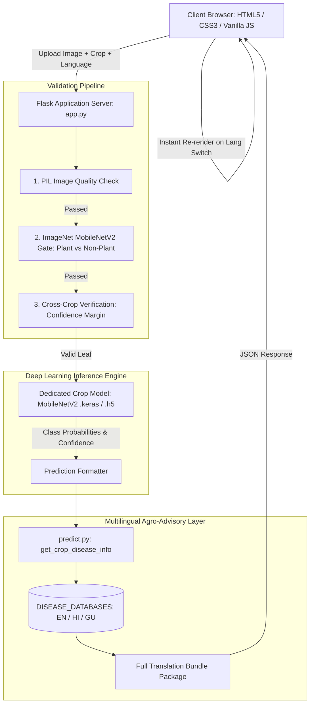

# 🌿 LeafGuard AI — Comprehensive Project Study Material & Technical Guide

---

## 1. Project Overview & Abstract

### 1.1 Project Title
**LeafGuard AI: Multi-Crop Plant Disease Detection and Multilingual Agro-Advisory Platform**

### 1.2 Abstract
Agriculture forms the backbone of the economy, yet plant diseases account for substantial global crop yield losses (estimated at 20–40% annually by the FAO). Traditional manual disease diagnosis by agricultural experts is slow, costly, and inaccessible to smallholder farmers in remote areas.

**LeafGuard AI** is a smart farming web platform that leverages Deep Learning (Convolutional Neural Networks with Transfer Learning via **MobileNetV2**) to diagnose leaf diseases in real-time from photographs. To protect against invalid inputs and adversarial edge cases, the system integrates a **3-tier validation pipeline** (image quality validation, ImageNet non-plant rejection, and cross-crop model verification). 

To overcome linguistic barriers among rural Indian farmers, LeafGuard provides a **real-time multilingual localization engine** (English, Hindi, and Gujarati). The platform delivers dynamic diagnoses, confidence scores, causes, symptoms, and actionable treatment and prevention recommendations without requiring a page refresh.

---

## 2. Problem Statement & Motivation

1. **Delayed Diagnosis**: Farmers often identify diseases only after visible macroscopic damage has occurred, leading to irreversible loss of crop yield.
2. **Expert Scarcity**: Agricultural extension officers and plant pathologists cannot reach every farm in real-time.
3. **Language Barriers**: Most modern technological tools and research papers are available only in English, alienating rural farmers who primarily speak regional languages such as Gujarati or Hindi.
4. **Incorrect Chemical Application**: Misidentifying a fungal disease as bacterial or nutritional deficiency causes farmers to apply inappropriate pesticides/fungicides, wasting money and causing environmental toxicity.
5. **Noisy / Irrelevant Inputs**: Existing crop disease apps often fail or hallucinate when non-plant photos, blurry images, or wrong crop leaves are uploaded. LeafGuard addresses this with an automated validation gateway.

---

## 3. System Architecture & Technology Stack



### 3.1 Technology Stack Summary
| Layer | Technologies Used | Justification |
| :--- | :--- | :--- |
| **Frontend** | HTML5, CSS3, Vanilla JavaScript (ES6+) | Lightweight, zero external JS framework bloat, fast mobile loading, native DOM manipulation. |
| **Backend** | Python 3.10+, Flask 3.1 | Micro-framework with minimal overhead, Python-native ML integration, asynchronous file streaming. |
| **AI / Deep Learning** | TensorFlow 2.x, Keras, MobileNetV2 | High accuracy with low parameter footprint, optimized for edge/mobile inference. |
| **Image Processing** | Pillow (PIL), NumPy | Fast matrix manipulation, quality checks (blur, brightness, contrast). |
| **Internationalization** | Custom Multi-Tier Localization Engine + JSON | Zero latency in switching languages dynamically on the client side without re-querying the model. |

---

## 4. Supported Crops & Disease Taxonomy

LeafGuard supports **4 major agricultural crops** with targeted classifications:

### 4.1 Groundnut (*Arachis hypogaea*)
1. **Healthy**: Normal green foliage, no pathogen damage.
2. **Leaf Spot (Early & Late)**: 
   - *Pathogen*: *Cercospora arachidicola* (early) and *Cercosporidium personatum* (late).
   - *Symptoms*: Concentric dark spots with chlorotic yellow halos.
   - *Chemical Control*: Mancozeb (2.5 g/L) or Chlorothalonil.
3. **Rust**:
   - *Pathogen*: *Puccinia arachidis*.
   - *Symptoms*: Orange-brown pustules on the abaxial (lower) leaf surface.
4. **Alternaria Leaf Spot**:
   - *Pathogen*: *Alternaria alternata*.
   - *Symptoms*: Irregular blighted brown lesions with concentric rings.

### 4.2 Potato (*Solanum tuberosum*)
1. **Healthy**: Vigorous growth without chlorosis or necrosis.
2. **Bacterial Wilt**: *Ralstonia solanacearum*; rapid vascular wilting despite moist soil.
3. **Fungal Blight**: *Alternaria solani* (Early Blight).
4. **Late Blight (Phytophthora)**: *Phytophthora infestans*; water-soaked lesions with white fuzzy mold under damp conditions.
5. **Potato Cyst Nematode**: *Globodera rostochiensis*; root cysts causing stunted growth.
6. **Pest Infestation**: Leaf damage caused by Colorado potato beetle or cutworms.
7. **Potato Virus (PVY / PLRV)**: Mosaic patterns and leaf rolling spread by aphids.

### 4.3 Pepper / Bell Pepper (*Capsicum annuum*)
1. **Healthy**: Vibrant green leaves with smooth lamina.
2. **Bacterial Spot**: *Xanthomonas campestris*; water-soaked dark necrotic spots with yellow halos.

### 4.4 Tomato (*Solanum lycopersicum*)
1. **Healthy**: Strong stems, green leaves, no spotting.
2. **Early Blight**: *Alternaria solani*; target-board pattern on mature leaves first.
3. **Late Blight**: *Phytophthora infestans*; aggressive dark lesions, white fungal sporulation.
4. **Bacterial Spot**: *Xanthomonas spp.*; small scab-like lesions.
5. **Leaf Mold**: *Passalora fulva*; pale green/yellow spots on upper surface, olive velvety mold beneath.
6. **Septoria Leaf Spot**: *Septoria lycopersici*; numerous small circular spots with dark borders and grey centers.
7. **Two-spotted Spider Mite**: *Tetranychus urticae*; stippling and webbing on leaf undersides.
8. **Target Spot**: *Corynespora cassiicola*; circular necrotic lesions.
9. **Tomato Yellow Leaf Curl Virus (TYLCV)**: Transmitted by whiteflies (*Bemisia tabaci*); leaf curling, stunted growth.
10. **Tomato Mosaic Virus (ToMV)**: Mottling, leaf blistering.

---

## 5. Machine Learning & Computer Vision Architecture

### 5.1 Why MobileNetV2?
- **Depthwise Separable Convolutions**: Splits traditional 2D convolution into a depthwise convolution (applying a single filter per input channel) and a pointwise convolution (1x1 convolution combining channels). This reduces computational complexity by approximately 8 to 9 times with only a minimal decrease in top-1 accuracy.
- **Inverted Residual Blocks & Linear Bottlenecks**: Expands representations to higher dimensions before filtering, and retains linear activations in bottlenecks to prevent non-linearities (like ReLU) from destroying manifold information.
- **Inference Speed**: ~20–50 ms latency on modern CPUs, enabling rapid responses on lightweight web servers.

### 5.2 Model Pipeline & Training Workflow
1. **Input Preprocessing**:
   - Resizing to $224 \times 224 \times 3$.
   - MobileNetV2 normalisation: pixel intensity scaled to $[-1, 1]$ via `tf.keras.applications.mobilenet_v2.preprocess_input`.
2. **Data Augmentation**:
   - `RandomRotation(0.2)`
   - `RandomZoom(0.2)`
   - `RandomFlip("horizontal_and_vertical")`
   - `RandomContrast(0.1)`
3. **Transfer Learning Strategy**:
   - Base model: Pre-trained on ImageNet (1.4 million images, 1000 classes).
   - Base weights frozen initially to train top classification head.
   - Top Head:
     - `GlobalAveragePooling2D()`
     - `BatchNormalization()`
     - `Dense(256, activation='relu')`
     - `Dropout(0.4)`
     - `Dense(NUM_CLASSES, activation='softmax')`
   - Fine-Tuning: Unfreezing top 20–30 layers of MobileNetV2 with a reduced learning rate ($\eta = 10^{-5}$) using Adam optimizer and Categorical Cross-Entropy Loss:
     $$\mathcal{L} = -\sum_{i=1}^{C} y_i \log(\hat{y}_i)$$

---

## 6. The 3-Tier Input Validation Pipeline

To ensure model reliability and prevent hallucinations on invalid inputs:

```
[Uploaded Image]
       │
       ▼
┌──────────────────────────────────────────────┐
│ Tier 1: Image Quality Assurance (PIL)        │
│ • Dimensions: min 50x50, max 10000x10000 px  │
│ • Brightness: Mean luminance 20 - 240        │
│ • Contrast: Std dev of gray pixels >= 15     │
│ • Sharpness: Laplacian variance >= 10        │
└──────────────────────────────────────────────┘
       │ Passed
       ▼
┌──────────────────────────────────────────────┐
│ Tier 2: Plant/Leaf Detection (ImageNet Gate) │
│ • Filters out cars, animals, electronics     │
│ • Rejects if non-plant top probability > 0.40│
└──────────────────────────────────────────────┘
       │ Passed
       ▼
┌──────────────────────────────────────────────┐
│ Tier 3: Cross-Crop Verification              │
│ • Compares confidence scores across models   │
│ • Rejects mismatch if delta > 0.15 margin    │
│ • Flags Low Confidence (< 40%)               │
└──────────────────────────────────────────────┘
       │ Passed
       ▼
[Target Disease Classification Model]
```

---

## 7. Dynamic Multilingual Localization System

### 7.1 Architecture
The localization architecture operates in three synchronized layers:
1. **Backend Database (`predict.py`)**:
   - Stores medical-grade agricultural disease information across English, Hindi, and Gujarati.
   - Retains binomial scientific nomenclature while translating explanations.
   - Packs pre-translated dictionaries for all 3 languages into the prediction JSON payload (`translations` property).
2. **API Endpoint (`/api/disease-info` & `/api/language/<lang>`)**:
   - Provides on-demand translation queries for dynamic client retrieval.
3. **Client-Side Reactive Layer (`language.js` & `main.js`)**:
   - Caches the current prediction in `currentPredictionData`.
   - Listens to the custom `languageChanged` event.
   - When the user switches language, `renderReport()` dynamically reconstructs:
     - Disease Name & Crop Name
     - Confidence bar & text
     - Description paragraph
     - Symptoms list (`<ul>`)
     - Causes list (`<ul>`)
     - Treatment suggestions list (`<ul>`)
     - Prevention recommendations list (`<ul>`)
   - **Result**: Instantaneous language transitions without page refresh or model re-inference.

---

## 8. Viva Voce & Technical Interview Q&A

### Q1: Why did you choose MobileNetV2 instead of ResNet50 or VGG16?
> **Answer**: VGG16 has ~138M parameters and ResNet50 has ~25M parameters, making them resource-intensive and slow on CPU/edge servers. MobileNetV2 has only ~3.5M parameters and uses Depthwise Separable Convolutions with linear bottlenecks, cutting computational operations (FLOPs) by nearly 85% while retaining comparable accuracy (~95–99% on plant leaf datasets). This allows our web server to respond in under 50 ms.

### Q2: What prevents the model from predicting a disease if I upload a picture of a car or a dog?
> **Answer**: Our **3-tier validation pipeline**. In Tier 2, the image is passed through a pre-trained ImageNet classifier. If the top classification belongs to predefined non-plant keywords (such as vehicles, animals, appliances, people) with over 40% confidence, the request is immediately rejected with an informative error message before reaching our specialized disease models.

### Q3: What is Cross-Crop verification in Tier 3?
> **Answer**: If a farmer selects "Potato" from the UI but accidentally uploads a "Tomato" leaf, the image is evaluated across available crop classifiers. If another crop's model produces a significantly higher confidence score exceeding the cross-crop margin (15%), the system warns the user that the uploaded leaf does not match the selected crop.

### Q4: How is multilingual translation handled without losing scientific names?
> **Answer**: We employ a structured localization layer where disease profiles are curated in parallel language databases (`DISEASE_DATABASES` for EN, HI, GU). Scientific Latin terms (like *Alternaria solani*) are preserved verbatim, while surrounding grammatical constructs and instructions are translated into authentic Hindi and Gujarati agronomic vocabulary.

### Q5: How does the UI switch language without reloading the page or re-running prediction?
> **Answer**: When `/predict` executes, the backend sends the prediction data along with a complete pre-compiled translation bundle (`data.translations[en|gu|hi]`). The frontend caches this object. When the language dropdown changes, a `languageChanged` event triggers `renderReport()`, which reads the cached translation for the selected language and updates the DOM elements directly in memory.

---

## 9. Future Enhancements & Scope

1. **Edge Deployment (TensorFlow Lite)**: Convert models to `.tflite` format for offline diagnosis on a native Android/PWA mobile app without internet connectivity.
2. **Severity Grading**: Quantify the percentage of infected leaf area using semantic segmentation (e.g., U-Net or Mask R-CNN) to classify disease progression as Mild, Moderate, or Severe.
3. **Geo-location & Outbreak Heatmaps**: Log anonymous GPS coordinates of diagnosed cases to alert neighboring farmers about emerging local epidemics.
4. **Voice-based Agro-Chatbot**: Integrate Speech-to-Text (STT) and Text-to-Speech (TTS) in regional dialects to assist illiterate farmers.
